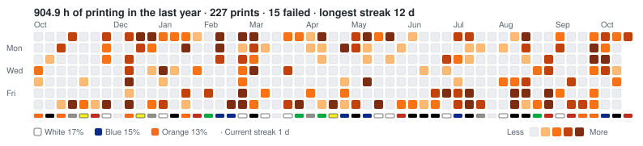
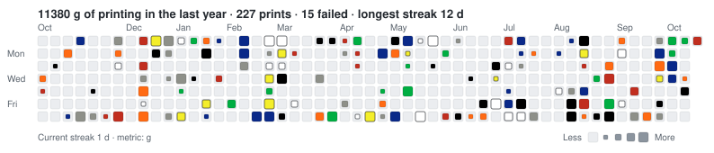

# print-heatmap

A GitHub-style contribution heatmap of your Bambu Lab 3D printing, for your profile README or a pinned gist. A GitHub Action fetches your print history from Bambu Cloud once a day, keeps it in an archive, and renders the charts.



The shade shows how much you printed each day, ranked against your own year like GitHub's quartiles. The strip underneath shows the filament colour you used most each week, and the caption names the top three.

With `colors: filament`, each day takes the colour of the filament it used most, and the dot size shows how much you printed:



For a pinned gist, it writes a text heatmap of the last 3 months, a row per month and a character per day, with the same levels as the SVG. A pinned gist shows only 5 lines, and this fits:

```
227 prints · 905 h · 11.4 kg · streak 12 d

Aug ··░··▒··░···▒███▓░·▓█░···▒··▒··  100 h
Sep ▓▓·██▒▓···▒·····▓·▓······▓▒██▒   106 h
Oct ·▒▒▓▒█▓···▒··░▒··▓                53 h
```

## Setup

### 1. Get a Bambu token and store it as a secret

Run this with [uv](https://docs.astral.sh/uv/) and the [GitHub CLI](https://cli.github.com). Replace `you/you` with the repo that will run the action, usually your profile repo:

```sh
uvx --from git+https://github.com/artemnovichkov/print-heatmap print-heatmap login --repo you/you
```

It asks for your Bambu Lab account email, emails you a sign-in code, and saves the token as the `BAMBU_TOKEN` secret of that repo. No password is needed, and the token never shows up on screen.

<details>
<summary>Other ways</summary>

- Without `--repo`, it prints the token instead, so you can add it in the repo settings (Settings → Secrets and variables → Actions):
  ```sh
  uvx --from git+https://github.com/artemnovichkov/print-heatmap print-heatmap login | pbcopy
  ```
- Without uv:
  ```sh
  git clone https://github.com/artemnovichkov/print-heatmap && cd print-heatmap
  PYTHONPATH=src python3 -m print_heatmap login --repo you/you
  ```
- From the browser: sign in at [bambulab.com](https://bambulab.com), open the developer tools, and under Application → Cookies → `https://bambulab.com`, copy the `token` cookie. Then run `gh secret set BAMBU_TOKEN --repo you/you` and paste it.
- For a China-region account (bambulab.cn), add `--region china` here and `region: china` to the workflow.

</details>

The token lasts about 3 months. When it expires, the workflow fails and GitHub emails you. Run `login` again to replace the secret. The charts stay as they were until then.

### 2. Add the workflow

`.github/workflows/print-heatmap.yml`:

```yaml
name: Print heatmap
on:
  schedule:
    - cron: "0 3 * * *"
  workflow_dispatch:
permissions:
  contents: write
jobs:
  heatmap:
    runs-on: ubuntu-latest
    steps:
      - uses: artemnovichkov/print-heatmap@v1
        with:
          bambu_token: ${{ secrets.BAMBU_TOKEN }}
          timezone: Europe/Berlin
```

Start it once from the Actions tab. It commits `print-heatmap.svg`, its `-light` and `-dark` variants, and `prints.json` to the `print-heatmap` branch.

### 3. Show it in your README

```html
<picture>
  <source media="(prefers-color-scheme: dark)" srcset="https://raw.githubusercontent.com/you/you/print-heatmap/print-heatmap-dark.svg">
  
</picture>
```

### Pinned gist (optional)

1. Create a public gist at [gist.github.com](https://gist.github.com) with any content. The action replaces it and renames the file.
2. Create a token that can edit gists: either a [fine-grained token](https://github.com/settings/personal-access-tokens/new) with the account permission **Gists: Read and write**, or a [classic token](https://github.com/settings/tokens/new?scopes=gist) with the `gist` scope.
3. Save it as the `GIST_TOKEN` secret, then add the gist to the workflow:
   ```yaml
          gist_id: 0123456789abcdef0123456789abcdef
          gist_token: ${{ secrets.GIST_TOKEN }}
   ```
4. Pin the gist on your profile (Customize your pins).

## Options

| Input | Default | |
|---|---|---|
| `bambu_token` | (required) | Bambu Cloud token |
| `metric` | `hours` | `hours` (real print time), `grams` (slicer estimate) or `prints` |
| `colors` | `activity` | `activity` (palette shade per day), or `filament` to colour each day by its main filament |
| `palette` | `orange` | Activity colours: `orange`, `blue`, `purple` or `green` |
| `filament_strip` | `true` | Strip of each week's main filament colour under the grid |
| `timezone` | `UTC` | IANA time zone for day boundaries |
| `titles` | `true` | Keep model names in `prints.json` and the tooltips |
| `region` | `global` | `china` for bambulab.cn accounts |
| `branch` | `print-heatmap` | Branch for the SVGs and `prints.json`; empty to skip committing |
| `gist_id` | | Gist to write the text summary into |
| `gist_token` | | Token with the gist scope |

## Command line

```sh
uvx --from git+https://github.com/artemnovichkov/print-heatmap print-heatmap update --demo --svg demo.svg
BAMBU_TOKEN=... print-heatmap update --svg heatmap.svg --text summary.txt --colors filament
print-heatmap update --offline --metric grams --svg heatmap.svg   # render prints.json without fetching
```

Run `print-heatmap update --help` for all options.

## What to know

- **Archive.** Bambu Cloud keeps only about 3 months of history. The action keeps every print it has seen in `prints.json`, so the year fills up over time. The first chart starts with whatever the cloud still has.
- **Missing prints.** Prints started from an SD card or USB stick, or from the printer's own file list, never reach the cloud.
- **Numbers.** Hours are real print time, from start to end. Grams are the slicer's estimate. Failed and cancelled prints are counted but add no hours or grams.
- **Privacy.** `prints.json` holds the date, duration, grams, filament colours and type, printer model, and, unless `titles: false`, the model name. It never holds the printer's serial number or account details. In a public repo, anyone can read it.
- **Unofficial API.** Bambu Lab doesn't document this API, and it can change without notice.

## Credits

Cloud endpoints come from [OpenBambuAPI](https://github.com/Doridian/OpenBambuAPI) and the [Home Assistant Bambu Lab integration](https://github.com/greghesp/ha-bambulab). The idea follows [Platane/snk](https://github.com/Platane/snk) and [waka-box](https://github.com/matchai/waka-box).

## License

MIT
